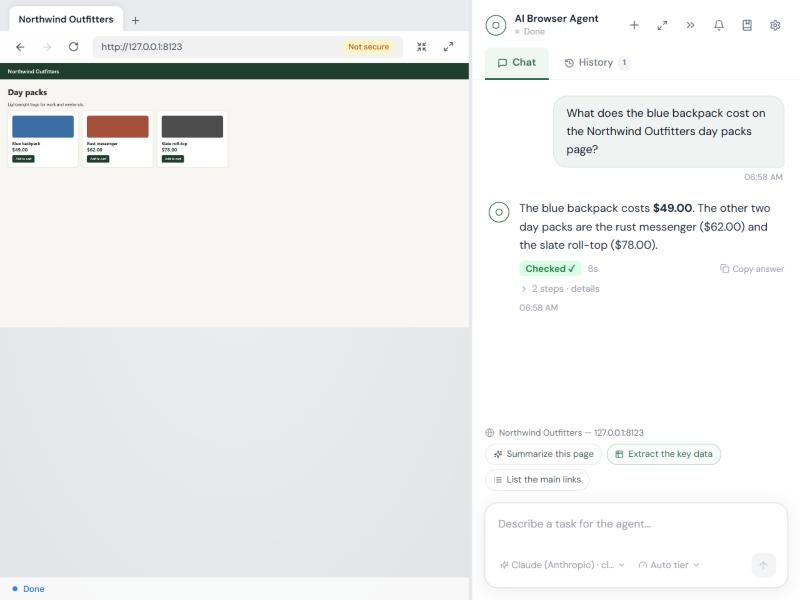

# AI Browser Agent

[](https://github.com/shefiu-adeyemi/ai-browser/actions/workflows/ci.yml)


Describe a task in plain English and an AI does it in a **real browser** while you watch a live view.
You can click and type in that view yourself, and every action that reaches other people or can't be
undone (sending, posting, buying, deleting) waits for your approval. A run you like can be **recorded
as a playbook** and replayed later, on a schedule, **without calling a model at each step**.



Built on [browser-use](https://github.com/browser-use/browser-use), a FastAPI server and a React UI.

## What it does

| | |
|---|---|
| **Live browser view** | See what the agent sees, take over at any time, browse by hand with tabs, back/forward and an address bar. |
| **A safety layer between the model and the browser** | Every action is classified in code before it runs: *allow*, *ask you first*, or *block*. A web page cannot talk the agent past it. [How it works](docs/architecture.md#safety-model) |
| **Five AI providers** | Claude, OpenAI, Gemini, DeepSeek and Qwen. DeepSeek's malformed answers are repaired before they fail a step. |
| **Model tiers and cost tracking** | A cheap *Fast* model for routine reads, a *Strong* one for second attempts, tokens counted per tier and model. |
| **Honest results** | An independent end-of-run check marks an answer *Checked* or *Needs review*; a run that hits its step limit pauses with **Continue**; **Stop** reports what was found so far. |
| **Playbooks** | Record a run, turn the changing parts into variables, replay it deterministically. AI is used only where judgement is needed, with self-repair when a page changes. |
| **Schedules and change watching** | Run playbooks unattended, within per-site daily limits that ramp up gradually, and get notified when what a page shows has changed. |

## Quick start

Needs **Python 3.12** and **Node.js 22+**. Developed and tested on Windows 11 (see [Platform notes](#platform-notes)).

```bash
git clone https://github.com/shefiu-adeyemi/ai-browser.git
cd ai-browser
pip install -e .                      # installs the app and its dependencies
cd frontend && npm install && npm run build && cd ..
python -m aiba                        # then open http://localhost:8000
```

Open **Settings** in the app, choose a provider and paste its API key. That is all the configuration a
first run needs. On Windows you can also double-click `launch.bat`.

> The first run downloads a Chromium for the agent if it can't find one.

## Configuration

Settings are edited in the app and stored **outside the project folder**, in
`%LOCALAPPDATA%\AIBrowserAgent` (set `AIBA_DATA_DIR` to move it), so keys never sit next to the code.
API keys and the stored login password are encrypted with Windows DPAPI.
[`.env.example`](.env.example) documents every option; the ones you are most likely to want:

| Setting | What it does |
|---|---|
| `LLM_PROVIDER`, `LLM_MODEL` | `claude`, `openai`, `gemini`, `deepseek` or `qwen`, and optionally a model name. |
| `AGENT_SPEED` | `fast` (shorter prompts, up to 3 actions per step; the default for DeepSeek) or `careful`. |
| `LLM_VISION` | Whether the model can see screenshots; decided from the model name unless you overrule it. |
| `APPROVAL_MODE` | `ask` (default) waits for you; `auto` approves only on the site your task names. |
| `MAX_STEPS`, `MAX_RETRIES` | The step budget per run and how often a failed check may trigger another attempt. |
| `AIBA_PORT`, `AIBA_DATA_DIR` | Run a second copy side by side (each gets its own session cookie). |

## Safety

- **Credentials** are only ever typed into the login form of the site they belong to; the model sees a
  placeholder, never the value.
- **Approval:** sending, posting, connecting, buying, deleting, downloading and running JavaScript need
  your click. **Auto** mode approves those only on the site the task names, declines the rest and logs every decision.
- **CAPTCHAs** are never solved by the agent; it hands the browser to you.
- **The control page is protected:** the server binds to localhost, requires a per-launch token, checks
  `Host` and `Origin` (against DNS rebinding and cross-site requests), and the agent's own browser cannot
  open the app's address, so it cannot approve its own requests.
- The app was audited and hardened item by item; the findings are in [docs/security-audit.md](docs/security-audit.md).

To report a vulnerability see [SECURITY.md](SECURITY.md).

## Testing

The model is the slow, expensive, nondeterministic part, so the tests replace it. `tests/fake_llm.py` is a
scripted stand-in that lets the **real browser-use agent run end to end against a real Chromium with no API cost**.

| | |
|---|---|
| Python, fast (no browser) | `python -m unittest discover -s tests` |
| Python, with a real Chromium (slower) | `RUN_BROWSER_TESTS=1 python -m unittest discover -s tests` |
| Frontend | `cd frontend && npm test` |
| Lint | `ruff check .` |

That is about 1,700 fast Python tests, about 110 real-browser tests and 184 frontend tests. CI
([`.github/workflows/ci.yml`](.github/workflows/ci.yml)) runs lint, the Python tests, the frontend tests, the build and `npm audit` on every push.

## Project layout

```
src/aiba/
  server/      FastAPI app, live view, approvals, the chat feed        (server/main.py is the entry point)
  agent/       the safety guard, run outcomes, navigation helpers
  llm/         providers, model selection, tiers and the usage ledger
  playbooks/   record, replay, repair and draft playbooks
  scheduling/  scheduler, per-site pacing limits, change watching
  storage/     settings, encrypted secrets, chats, snapshots
  cli/         the original command-line agents
frontend/      React + Vite + Tailwind UI (with its own tests)
tests/         unit and real-browser tests, plus the scripted fake model
packaging/     the Windows launcher and its .exe build
docs/          architecture, playbook design, the security audit
```

More detail, including how a task flows through the code, is in [docs/architecture.md](docs/architecture.md).

## Platform notes

- Developed and tested on **Windows 11**. Secret encryption uses Windows DPAPI; on other systems values are
  stored as plain text in the data folder, and the launcher and packaging are Windows-only. The core
  (agent, guard, playbooks, scheduler) is platform-neutral, but other systems have not been tested.
- The pinned `browser-use==0.13.10` is exact on purpose: its internals change between releases.
- `src/aiba/server/main.py` is large (it wires the server, the run lifecycle and the playbook routes together).
  Splitting it into routers is the next structural cleanup.

## Troubleshooting

- **Live view stays blank:** reload the page (a restarted server issues a new session cookie).
- **Port 8000 busy:** the launcher stops the previous copy of this app; if something else uses the port, close it or set `AIBA_PORT`.
- **The `.exe` says no Python has the packages:** run `pip install -e .`, or set `AIBA_PYTHON` to the Python that has them.

## Contributing and license

Contributions are welcome: see [CONTRIBUTING.md](CONTRIBUTING.md). Released under the [MIT License](LICENSE).
